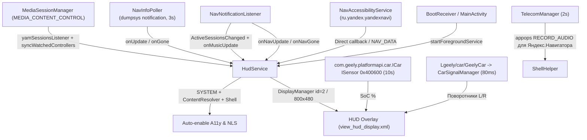

# Техническое описание приложения NavHUD (`com.e8.navhud`)

Документ составлен по результатам полного анализа декомпилированного пакета оригинального `com.e8.navhud.apk`.

---

## 1. Общие характеристики и сборка

| Параметр | Значение |
| :--- | :--- |
| **Package / Application ID** | `com.e8.navhud` |
| **Версия** | `versionCode = 1`, `versionName = "1.0"` |
| **SDK** | `minSdk = 26`, `targetSdk = 34`, `compileSdk = 34` |
| **Shared UID** | `android:sharedUserId="android.uid.system"` (выполняется с привилегиями `system` UID 1000) |
| **Подпись APK** | Стандартный AOSP platform/testkey (`SHA1: 27:19:6E:38:6B:87:5E:76:AD:F7:00:E7:EA:84:E4:C6:EE:E3:3D:FA`) |
| **Язык / Компиляция** | Kotlin (`mv = 2.2.0`), декомпилировано `apktool 3.0.2` в Smali + XML |

### Разрешения и видимость пакетов (`AndroidManifest.xml`)
- `SYSTEM_ALERT_WINDOW` — вывод системного оверлея поверх других окон.
- `FOREGROUND_SERVICE`, `FOREGROUND_SERVICE_DATA_SYNC` — работа `HudService` в фоне как Foreground Service.
- `RECEIVE_BOOT_COMPLETED` — автозапуск после загрузки ГУ.
- `WRITE_SECURE_SETTINGS` — программное самовключение собственных `AccessibilityService` и `NotificationListenerService`.
- `MEDIA_CONTENT_CONTROL` — прямой системный доступ к `MediaSessionManager.getActiveSessions(null)`.
- `READ_PHONE_STATE` — определение активных звонков (совместно с `TelecomManager.isInManagedCall()`).
- `android.car.permission.CAR_ENERGY_PORTS`, `android.car.permission.CAR_EXTERIOR_LIGHTS` — доступ к авто-API.
- `<queries>`: перечислены **только** `ru.yandex.yandexnavi`, `ru.yandex.music`, `com.spotify.music` (важно: пакета `com.tencent.wecarflow` там нет; кроме того, отсутствует разрешение `READ_EXTERNAL_STORAGE` / `READ_MEDIA_IMAGES` для чтения `file://` URI из общего хранилища).

---

## 2. Архитектура и жизненный цикл



### Основные классы (`com.e8.navhud`)
1. **`MainActivity.smali`**
   - Прозрачная Activity (`Theme.Translucent.NoTitleBar`, `singleInstance`, `excludeFromRecents="true"`).
   - Проверяет `Settings.canDrawOverlays()`: если не выдано, открывает `MANAGE_OVERLAY_PERMISSION`, иначе запускает `HudService` и сразу завершается без анимации.
2. **`BootReceiver.smali`**
   - `directBootAware="true"`. Слушает `BOOT_COMPLETED`, `MY_PACKAGE_REPLACED`, `ACTION_BOOT_IPO`, `QUICKBOOT_POWERON`, `LOCKED_BOOT_COMPLETED`.
   - С задержкой (`8000 мс` для `LOCKED_BOOT_COMPLETED`, `3000 мс` для остальных) включает `NavAccessibilityService` (через `Settings.Secure` + `ShellHelper`) и запускает `HudService`.
3. **`HudService.smali`**
   - Основной оркестратор приложения (`ForegroundService`, канал `hud_ch`, низкий приоритет уведомления `IMPORTANCE_MIN = 1`).
4. **`NavAccessibilityService.smali`**
   - Служба доступности для пакета `ru.yandex.yandexnavi` (`flagIncludeNotImportantViews | flagReportViewIds | flagRetrieveInteractiveWindows`, `canRetrieveWindowContent="true"`).
5. **`NavNotificationListener.smali`**
   - Слушатель системных уведомлений и второй (дублирующий) слушатель `MediaSessionManager`.
6. **`NavInfoPoller.smali`**
   - Фоновый поток опроса `dumpsys notification` раз в 3 секунды как запасной канал для навигации.
7. **`NavData.smali`**
   - Data-класс навигации: `maneuverDesc`, `distToManeuver`, `currentStreet`, `nextStreet`, `speed`, `speedLimit`, `eta`, `totalDistance`, `travelTime`, а также вычисляемые свойства `hasRoute` и `hasSpeed`.
8. **`ShellHelper.smali`** и **`ShellExecRunnable.smali`**
   - Выполнение команд через `/system/bin/sh -c` (`execSh`) и перебор бинарников `su` (`su`, `/system/xbin/su`, `/system/bin/su`, `/sbin/su` в `exec`) с таймаутом ожидания 10 секунд.

---

## 3. Подробный перечень всех возможностей `NavHUD`

### 3.1. Работа с проекционным дисплеем (HUD Overlay)
- **Выбор дисплея (`createHudDisplay`)**:
  1. Сначала запрашивает `DisplayManager.getDisplay(2)` (целевой ID проекционного дисплея на Geely E8).
  2. Если не найден — ищет любой не-основной дисплей (`displayId != 0`) с физическим разрешением **`800x480`** (`0x320 x 0x1e0`).
  3. Если не найден — берет первый попавшийся дисплей с `displayId != 0`.
- **Окно оверлея**:
  - Создается `createDisplayContext(display)` и его `WindowManager`.
  - Размеры: `MATCH_PARENT x MATCH_PARENT`, тип `TYPE_APPLICATION_OVERLAY` (`0x7f6`, fallback на `TYPE_SYSTEM_OVERLAY` `0x7d6`).
  - Флаги `0x138`: `FLAG_NOT_FOCUSABLE | FLAG_NOT_TOUCHABLE | FLAG_NOT_TOUCH_MODAL | FLAG_LAYOUT_IN_SCREEN` (окно полностью неинтерактивно и не перехватывает фокус/нажатия).
  - Фон [`hud_display_bg.xml`](../app/src/main/res/drawable/hud_display_bg.xml) — сплошной черный `#FF000000` (на оптике HUD черный цвет не светится и выглядит прозрачным).
- **Восстановление после сна (`screenOnReceiver`)**:
  - По `Intent.ACTION_SCREEN_ON` (с задержкой 2 с и 6 с) проверяет `hudDisplayView?.windowToken`: если оверлей отвалился после пробуждения ГУ, пересоздает его заново (`checkAndRecreateHudOverlay`), перепроверяет `AccessibilityService`, обновляет часы и вызывает `reevaluateActiveController()`.

### 3.2. Пользовательский интерфейс HUD ([`view_hud_display.xml`](../app/src/main/res/layout/view_hud_display.xml))
Рабочий layout — `view_hud_display.xml` (`view_hud_panel.xml` в коде не используется, это legacy-вариант с крупной горизонтальной плашкой):
- **Верхняя строка**:
  - `hudDisplayStatusRight` (`18sp`, белый, `sans-serif-condensed`) — текущие часы в формате `HH:mm` (обновляются раз в минуту через `updateClockRunnable`, а также при обновлении навигации/музыки).
  - `hudDisplayEta` (`14sp`, голубой `#00E5FF`, до `260dp`) — сводка маршрута (`eta · totalDistance · travelTime`).
  - `hudMusicRow` (справа, изначально `visibility="gone"`):
    - `hudDisplayMusicTitle` (`12sp`, белый, справа налево `gravity="end"`, `maxWidth="200dp"`, `1` строка).
    - `hudDisplayMusicArtist` (`10sp`, `#CCFFFFFF`, `maxWidth="200dp"`, `1` строка).
    - `hudDisplayMusicArt` (`32dp x 32dp`, `ImageView`, `scaleType="centerCrop"`, изначально `gone`).
- **Навигационный блок**:
  - `hudDisplayStreet` (`11sp`, `#80FFFFFF`) — текущая улица.
  - `hudDisplayArrowImage` (`48dp x 48dp`) — векторные иконки маневров (`man_directions_*`: прямо, налево/направо, круто, плавно, съезд, слияние, кольцо, разворот, финиш), подбираемые по ключевым словам в тексте маневра.
  - `hudDisplayArrow` (`36sp`) — текстовый fallback со стрелками Unicode (`↑ → ← ↗ ↖ ↩ ↻ ▸`), если вектор не подошел.
  - `hudDisplayDistance` (`32sp`, `#00E5FF`, `sans-serif-light`) — расстояние до маневра (например, `через 300 м`).
  - `hudDisplaySpeedLimitContainer` + `hudDisplaySpeedLimit` (`40x40dp`, красный круг [`speed_limit_circle.xml`](../app/src/main/res/drawable/speed_limit_circle.xml)) — знак ограничения скорости.
  - `hudDisplaySubtitle` (`16sp`, белый) — следующая улица или подзаголовок маневра.
- **Нижний блок (`marginBottom="82dp"` — над штатной нижней зоной проекции)**:
  - Заряд батареи ВВБ: `hudBatteryIcon` (`22x12dp`, `ClipDrawable` + `PorterDuffColorFilter`) и `hudBatteryLevel` (`16sp`, `%`).
  - Индикаторы поворотников: `hudTurnLeft` (`24x24dp`, зеленый `#00E676`) и `hudTurnRight` (`24x24dp`, зеленый `#00E676`).
- *Примечание*: в метаданных Kotlin и `R$id`/`R$drawable` присутствуют остатки удаленной ранее функции оповещения о камерах (Стрелка): `hudStrelkaRow`, `hudStrelkaIcon`, `hudStrelkaLimit`, `hudStrelkaDist`, `StrelkaReceiver`, `ic_strelka_camera`, `strelka_alert_bg`, но сама логика в APK отсутствует.

### 3.3. Навигация из Яндекс.Навигатора (`ru.yandex.yandexnavi`)
Реализована тройная система извлечения маршрута:
1. **`NavAccessibilityService` (основной канал)**:
   - Реагирует на `AccessibilityEvent` (не чаще раза в 500 мс) + опрос раз в 2000 мс (`pollRunnable`).
   - Ищет окно с `packageName == "ru.yandex.yandexnavi"`, собирает все непустые узлы (`text` / `contentDescription`).
   - В `parseNavData()` по регулярным выражениям и ключевым словам (`MANEUVER_KEYWORDS`, фильтрация `UI_NOISE` вроде `"поиск"`, `"маршрут"`, `"пробки"` и т.д.) выделяет скорость, ограничение скорости, время прибытия, дистанцию/время в пути, дистанцию до маневра, описание маневра, текущую и следующую улицы.
   - Передает `NavData` в `HudService` через коллбэк `onNavDataDirect` (или через internal broadcast `com.e8.navhud.NAV_DATA` / `com.e8.navhud.NAV_GONE`).
2. **`NavNotificationListener` (дополнительный канал)**:
   - Ловит `onNotificationPosted` / `onNotificationRemoved` для `ru.yandex.yandexnavi`.
   - `HudService.showHud()` дополнительно проверяет текст regex'ом `isGuidanceText()` (наличие чисел с единицами `м`, `км`, `мин`, `ч`), чтобы отбросить не-навигационные уведомления.
3. **`NavInfoPoller` (shell-фоллбэк)**:
   - Раз в 3 секунды выполняет `dumpsys notification --noredact | grep -A 25 'pkg=ru.yandex.yandexnavi'` и парсит `android.title`, `android.text`, `android.subText`.
- **Автоскрытие навигации**: `hideHudRunnable` срабатывает через `20 000 мс` (`HUD_AUTO_HIDE_MS`), однако если `isNavAppRunning()` возвращает `true` и маршрут активен (`hudNavActive`), скрытие переносится еще на 20 с.

### 3.4. Интеграция с телеметрией и шиной автомобиля Geely
1. **Уровень заряда батареи (SoC)**:
   - Подключается к `com.geely.platformapi.car.Car.create(context)` (`IConnectable.connect()`).
   - Раз в 10 секунд (`socPollRunnable`) читает датчик `0x400600` (`ISensor.getSensorLatestValue(0x400600)`), округляет (диапазон `1..100%`).
   - Обновляет текст `%`, заполнение клипа `level = pct * 100` и цвет:
     - `< 10%`: красный (`#FFFF1744`)
     - `10..20%`: оранжевый (`#FFFF9100`)
     - `> 20%`: зеленый (`#FF00E676`)
2. **Сигналы поворота**:
   - Получает системный сервис `"geelycar_service"` (`IGeelyCar.Stub.asInterface`) -> `GeelyCar.createCar()` -> `getCarManager("car_signal")` -> `Lgeely/car/hardware/signal/CarSignalManager`.
   - В выделенном потоке `"NavHudSignal"` каждые **80 мс** (`turnPollRunnable`) вызывает `getExtrLtgStsTurnIndrLe()` и `getExtrLtgStsTurnIndrRi()`.
   - Реализовано удержание активности поворотника в течение `700 мс` (`0x2bc`) с плавной анимацией прозрачности `alpha` за `90 мс` (`animateTurnIndicator`) для синхронного отображения фаз мигания.
   - *(В коде также есть неиспользуемый `carPropCallback` для стандартного `CarPropertyManager` с ID `0x11400408` — оставлен как запасной/архивный).*

### 3.5. Сервисные функции: удержание Навигатора и управление микрофоном
1. **Защита Яндекс.Навигатора от убийства системой (`keepYanAlive`)**:
   - Вызывается при старте, пробуждении экрана, обновлении маршрута и периодически каждые **30 секунд** (`yanKeeperRunnable`):
     - `dumpsys deviceidle whitelist +ru.yandex.yandexnavi`
     - `am set-inactive ru.yandex.yandexnavi false`
     - `am set-standby-bucket ru.yandex.yandexnavi active`
     - Сбрасывает `/proc/<pid>/oom_score_adj` в `0` (с fallback через `su`).
     - Если маршрут активен (`routeSeen == true`), но `isForeground=true` у сервисов Навигатора нет — вызывает `am startservice ru.yandex.yandexnavi/com.yandex.navikit_platform.guidance.service.GuidanceService`.
2. **Автовосстановление `AccessibilityService` и `NotificationListener`**:
   - При старте (сразу, +2с, +8с), при `SCREEN_ON` и через `ContentObserver` на `enabled_accessibility_services` принудительно дописывает свои сервисы в `Settings.Secure` (через `ContentResolver` и через `settings put secure` в `sh`).
3. **Арбитраж микрофона во время звонка (`micPollRunnable`)**:
   - Каждые **2 секунды** опрашивает `TelecomManager.isInManagedCall()`.
   - Когда идет звонок — отбирает микрофон у Навигатора (`appops set ru.yandex.yandexnavi RECORD_AUDIO deny`), чтобы голосовой ассистент не перехватывал звук; после завершения звонка (или в `onDestroy`) возвращает `allow`.

---

## 4. Как сейчас работает музыка в `NavHUD` и причины проблемы со Spotify

### Текущая реализация музыки в `NavHUD`
`NavHUD` пытается получать музыку **только напрямую из Android `MediaSessionManager`** через два конкурирующих механизма:
1. **`HudService.startMusicMonitor()`**:
   - Подписывается на `MediaSessionManager.addOnActiveSessionsChangedListener(yamSessionsListener, null)` (используя `MEDIA_CONTENT_CONTROL`).
   - Вешает `makeWatchCallback` на все найденные контроллеры из белого списка `MUSIC_PKGS`.
   - Выбирает «главный» контроллер в `pickMusicController()`:
     ```kotlin
     private val MUSIC_PKGS = listOf(
         "com.spotify.music",
         "ru.yandex.music",
         "ru.yandex.yandexnavi",
         "com.android.bluetooth"
     )
     ```
     Если контроллер в `STATE_PLAYING (3)` — его оценка `0 + индекс_в_списке`, иначе `10 + индекс_в_списке`.
2. **`NavNotificationListener` (параллельный дублирующий контур)**:
   - Тоже подписывается на `MediaSessionManager` со своим `ComponentName` и при изменении метаданных/состояния вызывает `onMusicUpdate(title, artist)` / `onMusicGone()`, которые проброшены в `HudService.updateMusicDisplay()` / `clearMusicDisplay()`.

### Почему на HUD сейчас видна только обложка Spotify и не пропадает при его выключении

1. **`NavHUD` вообще не знает о `WeCarFlow` (`com.tencent.wecarflow`)**:
   - Нашего плеера нет в `MUSIC_PKGS` (как и системного BT-пакета OneOS `com.anwsdk.service`).
   - `NavHUD` не имеет `BroadcastReceiver` для интента `com.geely.navhud.metadata_update` (`GeelyMediaBridge.ACTION_GEELY_NAVHUD_UPDATE`) или `com.geely.music.metadatachanged`, которые уже отправляет `WeCarFlow` для DimMenu.
   - Более того, в `GeelyMediaBridge.kt` (проект WeCarFlow) для источников `SPOTIFY` и `BLUETOOTH` системная `WeCarFlowSession` умышленно переводится в `STATE_NONE`.

2. **Состояние `STATE_PAUSED (2)` считается активным воспроизведением**:
   - В `HudService.bindYamController()`, `HudService.refreshMusicNow()` и `NavNotificationListener` отображение музыки разрешено для состояний `2 (PAUSED)`, `3 (PLAYING)` и `6 (BUFFERING)`.
   - Когда вы переключаетесь в `WeCarFlow` со Spotify на Радио / USB / SoundCloud / Bluetooth или закрываете UI, сам `com.spotify.music` ставится на паузу и остается в фоне в состоянии `STATE_PAUSED (2)`.
   - `pickMusicController()` не видит `com.tencent.wecarflow` (потому что его нет в списке), находит единственный знакомый пакет — `com.spotify.music` (пусть и на паузе, оценка `10 + 0 = 10`), привязывается к нему и **постоянно показывает старый трек и обложку Spotify**.
   - Кроме того, в `HudService$yamMediaCallback$1.onPlaybackStateChanged` любое состояние кроме `0 (NONE)` и `1 (STOPPED)` вызывает `refreshMusicNow()`, а таймер `yanKeeperRunnable` каждые 30 секунд при `!hudMusicActive` повторно дергает `reevaluateActiveController() + refreshMusicNow()`.

3. **Конфликт `NavNotificationListener` и `loadAndApplyArt` с закэшированной обложкой**:
   - `NavNotificationListener` дергает `updateMusicDisplay(title, artist)` **без** вызова `loadAndApplyArt()`, из-за чего текст может обновиться, а старая обложка в `hudDisplayMusicArt` останется висеть.
   - В `HudService.loadAndApplyArt()` при `!trackChanged` (если название и артист совпали с `lastTrackKey`), но отсутствии новой картинки ветка `applyArt(null)` пропускается.

4. **Поведение при выключении/разрыве внешнего Spotify в самом `WeCarFlow`**:
   - В `SpotifySourceAdapter.kt` (проект WeCarFlow) метод `onSessionDestroyed()` при завершении сессии Spotify переводит адаптер в `PlaybackStatus.PAUSED`, а не `STOPPED`/`DISCONNECTED`, и сохраняет метаданные последнего трека; а `findAndBindSpotifySession()` при исчезновении сессии из списка вообще не сбрасывает контроллер.
   - При закрытии самого `WeCarFlow` (`MainActivity.onDestroy()` / `AppTaskWatcherService.onTaskRemoved()`) `GeelyMediaBridge.stopSync()` не вызывает `clearSystemMetadata()`.
